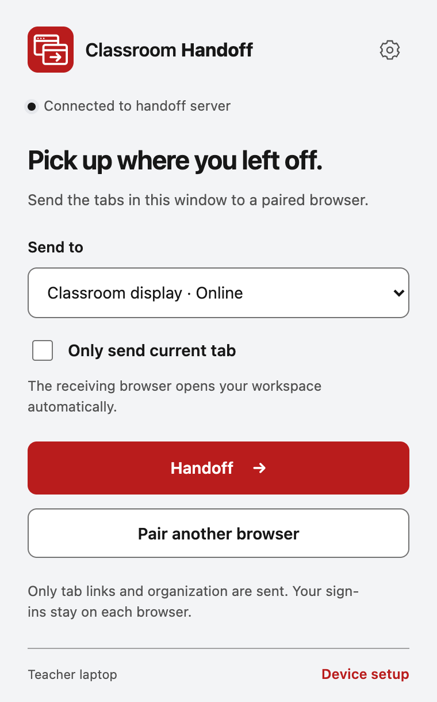
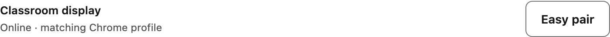
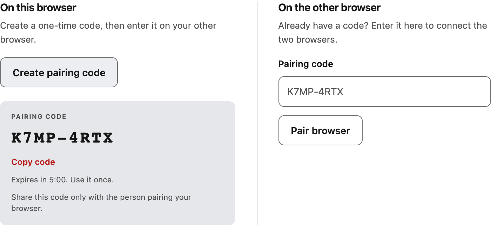

# Classroom Handoff

## 1. Send your lesson

Move your website tabs from one Chrome browser to another, such as from your laptop to a classroom display. Your original tabs stay open.

Already paired your browsers? Start here. First time using Handoff? [Start with setup](#2-first-time-connect-and-pair-once), then return here.

<!-- pdf:columns -->

### 1. Get both browsers ready

Open Chrome on both computers. Keep the receiving computer awake and connected to the internet. On your sending computer, open the window containing your lesson tabs.

### 2. Choose where to send

Click the red **Classroom Handoff** icon near Chrome's address bar. Under **Send to**, choose the browser you want. Check that its name says **Online**.

### 3. Click Handoff

The receiving browser opens your tabs automatically. Wait for **Workspace opened**. You do not need to click Accept for each handoff.

<!-- pdf:endcolumns -->

### One tab or the whole window?

- **All lesson tabs:** leave **Only send current tab** unchecked. Handoff sends supported website tabs from this window.
- **Just one page:** select that tab first, then check **Only send current tab**. This choice is remembered, so check it before your next send.

> **Sending again?** The next handoff replaces the receiving browser's previous Handoff tabs. Move a tab to a separate window first if you want to keep it. Unrelated tabs and windows stay open.

<!-- pdf:page -->

## 2. First time? Connect and pair once

**Pairing** means connecting two browsers so they can send tabs to each other. You only need to do this once for each pair of browsers.

### Find Classroom Handoff

Open Chrome on both computers in your usual school or work profile. Click the red Handoff icon near the address bar. If it is hidden, open **Extensions** (the puzzle-piece button) and choose **Classroom Handoff**. Pin it if Chrome offers that option.

If it is missing, ask IT to install it. No separate Handoff account is needed.

### Connect each browser

1. Open Handoff, then **Device setup** or **Set up this browser**.
2. If the browser is already connected, continue below. Otherwise, enter the **Handoff server address** provided by your IT team and a name you will recognize, such as **Teacher laptop** or **Room 12 display**.
3. Click **Connect browser** and allow access to that server if Chrome asks. Repeat on the other browser. Both must use the same server address.

Your school may set and lock the server address for you. Leave it as provided. If setup is blocked or the address is missing, ask IT.

### Use Easy pair

1. Choose **Pair another browser**. **Suggested browsers** appear automatically when both browsers are online, use the same Handoff server, and have the same primary account signed into Chrome itself.
2. Find the browser you recognize and click **Easy pair**.
3. On the other computer, open Handoff. Check the requesting browser's name and click **Accept**. Choose **Decline** if you do not recognize it.
4. When pairing finishes, return to the Handoff window and choose that browser under **Send to**.

> **Nothing suggested?** [Pair with a code](#3-no-suggestion-pair-with-a-code). Signing into Gmail or another website alone does not enable suggestions. Easy pair requests expire after five minutes.

<!-- pdf:page -->

## 3. No suggestion? Pair with a code

Codes work even when the browsers use different Chrome accounts. Both browsers still need to be connected to the same Handoff server.

### On your first computer

1. Open Handoff and choose **Pair another browser**.
2. Under **Use a code**, click **Create pairing code**.
3. Use **Copy code**, or write down the eight letters and numbers, like **K7MP-4RTX**.

### On your other computer

1. Open Handoff and choose **Pair another browser**.
2. Under **Use a code**, enter the code in the **Pairing code** box.
3. Click **Pair browser**. [Send your lesson](#1-send-your-lesson) to try your first handoff.

> **Use a fresh code.** Codes expire after five minutes and can be used only once. Creating another code replaces the previous one. The code pictured here is only an example.

### Make your browsers easy to recognize

In **Device setup**, change **Browser name** and click **Save name**. Try **Room 12 display**. Under **Appearance**, choose **System**, **Light**, or **Dark**.

> **Pair only with browsers you trust.** Once paired, either browser can open incoming Handoff tabs automatically. In Device setup, use **Remove** beside a paired browser when you no longer want that connection.

<!-- pdf:page -->

## 4. Quick fixes and good habits

### The other browser says Offline

Wake the receiving computer and open Chrome in the profile where Handoff is installed. Check its internet connection. Open Handoff on both computers and allow about a minute to reconnect.

### My browser is not in the list

**Send to** shows paired browsers. Choose **Pair another browser** to add one. If Suggested browsers is empty, use a code. Browsers already paired do not appear as new suggestions.

### A code is rejected

Create a fresh code and enter it on the other browser within five minutes. Check that both use the same server address. Lowercase letters, spaces and hyphens are accepted. If you have tried several times, wait a minute before trying again.

### Handoff is waiting, failed, or expired

Check the receiving computer before sending again; the tabs may already have opened. Make sure Chrome is open and online. Waiting means the handoff is not yet confirmed. With the usual server settings, it expires after about two minutes without confirmation.

### A tab is missing, or the wrong amount was sent

Check **Only send current tab**; it remembers your last choice. Chrome settings, new-tab pages and local files cannot be sent. If you send only the current tab, select a normal website first. Handoff will not substitute a different page if that selected tab cannot be sent.

### The page opens but asks me to sign in

Sign into that website on the receiving browser. Handoff sends website links and tab organization, including pinned tabs and supported groups. It does not copy passwords, website sign-ins, unsaved typing or your exact place on a page. Save your work first.

> **Workspace opened** means Chrome opened the tabs. A website may still be loading, asking for sign-in, or showing its own permission prompt.

### Still need a hand?

Tell IT the two browser names, what you clicked, and the message you saw. Hide private information in screenshots. Avoid **Disconnect** as a quick fix: it removes this browser's setup and pairings.

---

Guide for Classroom Handoff 0.2.4. Updated November 14, 2026. Pictures use example browser names and a non-working example code. Screens may look slightly different in dark mode or on a school-managed browser.
